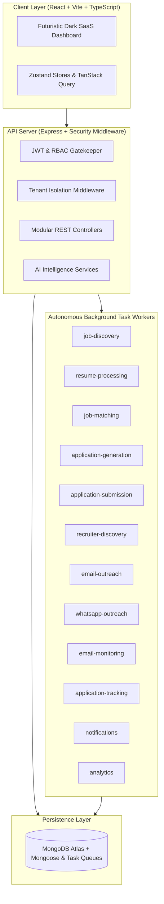

# AutoApply AI - System Architecture

## Overview
**AutoApply AI** is an autonomous SaaS platform engineered to eliminate repetitive job hunting tasks through authorized connectors, factual AI agents, distributed BullMQ queues, and multi-tenant isolation.

---

## 1. High-Level Topology

---

## 2. Core Intelligent Agents

1. **AI Resume Intelligence Agent (`ResumeIntelligenceService`):**
   - Parses raw document buffers (PDF & DOCX via `pdf-parse` and `mammoth`).
   - Extracts structured facts: Skills (with verified seniority and experience), Work History, Quantified Achievements, and Projects.
   - Calculates candidate profile completeness score (0-100) and supplies actionable tips.
   - Preserves original resumes permanently.

2. **AI Job Matching Engine (`JobMatchingService`):**
   - Evaluates opportunities using configurable weighted scoring:
     - Skills: 35%
     - Experience: 25%
     - Job Title: 15%
     - Location: 10%
     - Seniority: 10%
     - Keywords: 5%
   - Incorporates vector semantic embeddings (OpenAI `text-embedding-3-small`).
   - Evaluates strict mandatory eligibility constraints (workplace type, legal work authorization, regional requirements).

3. **AI Application Generation Agent (`ApplicationGenerationService`):**
   - Synthesizes job-tailored resume bullet points and summary statement.
   - Composes company-specific cover letter.
   - Answers standard ATS screening questions factually.
   - Freezes immutable `ApprovedSnapshot` for auditability.

4. **Autonomous Application Submission Engine (`ApplicationSubmissionService`):**
   - Adapter pattern implementation for Greenhouse, Lever, and permitted Playwright browser automation.
   - Guarded against bot-prohibited domains, anti-bot challenges, and CAPTCHAs with automatic fallback to manual handoff.

5. **AI Recruiter Outreach & WhatsApp Agent (`RecruiterOutreachService`, `WhatsAppBusinessService`):**
   - Finds publicly available talent partners.
   - Dispatches 1-to-1 personalized emails with mandatory opt-out clauses.
   - Dispatches Meta WhatsApp Business Cloud API alerts for urgent interview notifications.

6. **Email & Reply Intelligence Agent (`EmailMonitoringService`):**
   - Continuously checks connected mailboxes.
   - Classifies replies: interview invitation, polite rejection, technical assessment, salary inquiry.
   - Extracts interview calendar slots and meeting links.

